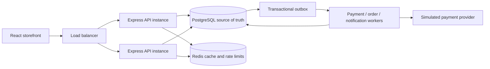
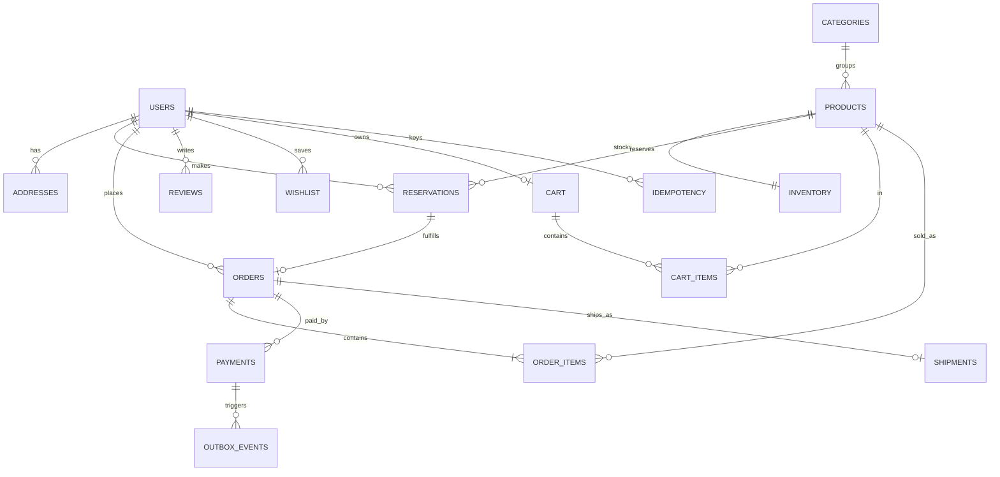
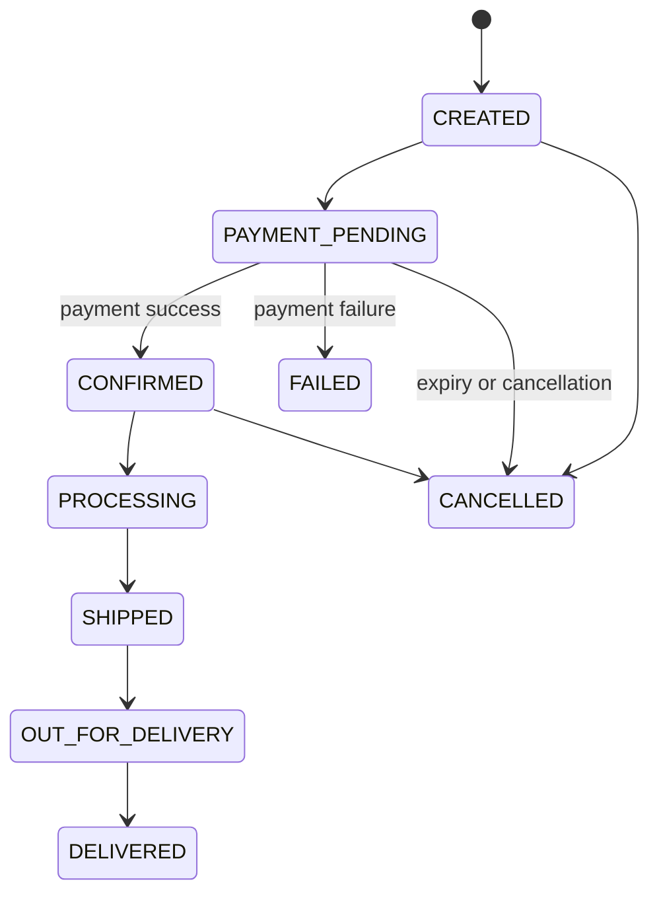
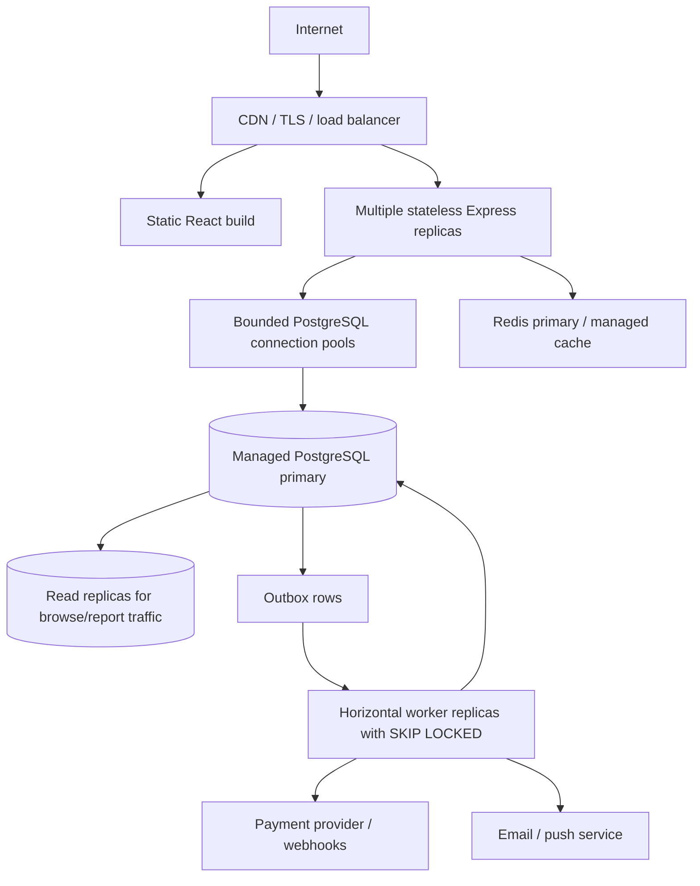

# ShopZen

ShopZen is a complete, runnable e-commerce demo built around one important guarantee: PostgreSQL decides who gets the last unit. The responsive storefront, REST API, seeded catalogue, reservations, simulated payments, order recovery worker, tracking, and admin view are included.

## Run it locally

Requirements for the instant local demo: Node.js 20+ and npm. `npm run dev` starts an embedded, persistent PostgreSQL-compatible development database, applies the schema, seeds the catalogue and starts the API and storefront. Local database files live under `.local/shopzen-pg/` and are ignored by Git. The embedded database is for the single-process local demo; use PostgreSQL 16+ and Redis 7+ for the production-style multi-instance/load-test setup.

From the ShopZen folder:

```powershell
npm install
npm run dev
```

Open [http://localhost:5173](http://localhost:5173). The API is at [http://localhost:4000/api](http://localhost:4000/api); `GET /api/health` reports PostgreSQL and Redis status.

For a standard PostgreSQL + Redis run, use Docker Desktop (or managed services), copy `.env.example` to `.env`, run `docker compose up -d postgres redis`, then `npm run db:migrate`, `npm run db:seed`, and `npm run dev:services`. The Docker database connection in `.env.example` is `shopzen` / `shopzen`.

Demo customer: `hello@shopzen.demo` / `ShopZen123!`  
Demo admin: `admin@shopzen.demo` / `ShopZenAdmin2026!`

For a real deployment, replace `JWT_SECRET`, use private database/cache credentials, set `NODE_ENV=production`, and use TLS. `.env.example` lists the supported settings. Never commit `.env`.

## Flash sale and concurrency proof

The seeded `FLASH-NOVA-001` product begins with exactly **100 units**. Seeding is idempotent and will not reset an already-running flash sale. To run the 10,000-request API simulation, use the standard PostgreSQL + Redis setup described above. In `.env`, set `RATE_LIMIT_MAX=12000`, then restart the API. In another terminal:

```powershell
npm run load:flash-sale
```

Expected proof: at most 100 HTTP 201 reservations, the remaining requests receive HTTP 409, `available >= 0`, and `overselling: 0`. The load script uses 10,000 distinct idempotency keys. By default it refuses to overwrite existing flash-sale history. To explicitly clear only the flash-sale product's demo reservations/orders/payments and restore its 100 units before a fresh run:

```powershell
npm run load:flash-sale -- --reset
```

The reset option is destructive to that single seeded flash-sale product's demo history. The API rate limit is deliberately configurable; use a high value only for a local load run.

Set `LOAD_USERS` and `LOAD_CONCURRENCY` to adjust the simulation size, for example:

```powershell
$env:LOAD_USERS=10000
$env:LOAD_CONCURRENCY=500
npm run load:flash-sale
```

Run the integration scenarios against a seeded local database:

```powershell
npm test
```

Coverage includes 10,000 simultaneous claims against 100 units, one item/two buyers, duplicate Buy Now, failed payment, payment timeout, reservation expiry, and a successful payment retried through duplicate order processing. Tests restore the flash-sale inventory and remove their test records before and after each scenario.

The checkout page also exposes **SUCCESS**, **FAILED**, **TIMEOUT**, and **DUPLICATE** payment outcomes. `DUPLICATE` injects a transient order-processing failure after the successful payment is committed; the outbox worker retries order creation. The payment is durable even while the order is being recovered.

## What's implemented

- Home, product listing/search/sort/category browsing, product detail, flash sale, cart drawer, checkout, simulated payment, orders, order tracking, profile, wishlist, and admin dashboard.
- Customer registration and login with bcrypt password hashes, signed JWTs, role checks, request validation, secure headers, structured request logs, and configurable rate limiting.
- PostgreSQL schema for users, products, categories, inventory, reservations, cart, cart items, orders, order items, payments, shipments, addresses, reviews, wishlist, idempotency, and an outbox queue.
- Redis-backed product/category read cache and shared rate-limit store; read routes continue from PostgreSQL if Redis is unavailable.
- Horizontal API scaling: stateless API instances share PostgreSQL and Redis. Keep worker instances running alongside the API; PostgreSQL row locks and unique constraints coordinate them.
- Seeded products across mobile, laptops, audio/tech, fashion, beauty, home and living, and accessories, with images, stock, ratings, discounts, and reviews.

## Inventory and order reliability

Buy Now runs in a PostgreSQL transaction. It first checks the caller's `(user_id, idempotency_key)`, then executes the atomic conditional update:

```sql
UPDATE inventory
SET available = available - $quantity,
    reserved = reserved + $quantity,
    updated_at = now()
WHERE product_id = $product_id AND available >= $quantity
RETURNING available, reserved;
```

The successful claim and its reservation commit together. Concurrent requests contend on the inventory row; once stock reaches zero, the predicate matches no row. `CHECK(available >= 0)` provides a second database-level guard. There is no read-modify-save inventory path.

State progression:

```text
AVAILABLE → RESERVED → PAYMENT_PENDING → CONFIRMED → SOLD
                 ↘ payment failure / timeout / expiry → RELEASED
```

`available` is sellable stock; `reserved` is held stock; `sold` is finalized stock. A five-minute reservation expiry worker reclaims timed-out or abandoned holds using `FOR UPDATE SKIP LOCKED`. A payment that has already succeeded is never expired: the outbox worker continues its order retry instead. Failed payment releases stock transactionally. Payment requests are idempotent through a unique key; reservations, orders, and provider references have database uniqueness constraints.

The outbox pattern writes asynchronous work in the same transaction as the payment state. A worker claims pending work and retries failures with exponential delay. Payment success is committed first; if order creation hits a transient error, the successful payment and pending `order.create` event remain durable for retry/reconciliation. Order creation itself is idempotent through the unique `orders.reservation_id`. For a production deployment, run a dedicated queue/worker deployment and add provider webhooks, dead-letter handling, alerting, and a periodic payment/order reconciliation job. This demo's PostgreSQL outbox is the durable queue; it does not require a separate broker to demonstrate recovery.

## API map

`POST /api/auth/register`, `POST /api/auth/login`, `GET /api/auth/me`  
`GET /api/categories`, `GET /api/products?q=&category=&sort=`, `GET /api/products/:id`, `GET /api/flash-sale`  
`GET|POST /api/cart`, `DELETE /api/cart/:productId`, `GET|POST|DELETE /api/wishlist`  
`POST /api/reservations`, `POST /api/checkout`, `POST /api/payments`, `GET /api/payments/:id`  
`GET /api/orders`, `GET /api/orders/:id`, `POST /api/orders/:id/cancel`  
`GET /api/profile`, `POST /api/profile/addresses`  
Admin: `GET /api/admin/overview`, `GET /api/admin/events`, `PATCH /api/admin/orders/:id`

Pass a fresh `Idempotency-Key` header on each new Buy Now/checkout/payment operation. Reuse the same key to safely retry that same operation. Payment body accepts `mode: SUCCESS | FAILED | TIMEOUT | DUPLICATE` for the simulation.

## System architecture



## Database ER



## Purchase sequence

```mermaid
sequenceDiagram
  actor Shopper
  participant API as Express API
  participant DB as PostgreSQL
  Shopper->>API: Buy Now + Idempotency-Key
  API->>DB: BEGIN; check existing key
  API->>DB: conditional UPDATE inventory WHERE available >= qty
  alt stock claimed
    DB-->>API: updated inventory row
    API->>DB: INSERT reservation + key; COMMIT
    API-->>Shopper: RESERVED, expiry time
  else no stock
    DB-->>API: no rows
    API-->>Shopper: 409 sold out
  end
```

## Payment sequence

```mermaid
sequenceDiagram
  actor Shopper
  participant API
  participant DB as PostgreSQL
  participant Worker as Outbox worker
  Shopper->>API: POST payment + idempotency key
  API->>DB: payment PENDING + payment.process event (one transaction)
  API-->>Shopper: accepted
  Worker->>DB: process simulated provider outcome
  alt payment failed
    Worker->>DB: FAILED + release reserved inventory
  else payment succeeded
    Worker->>DB: SUCCESS + order.create event
    Worker->>DB: create order, items, shipment; mark reservation sold
    Note over Worker,DB: transient failure leaves event pending for retry
  else timeout
    Worker->>DB: TIMEOUT; reservation expiry later releases stock
  end
```

## Order lifecycle



The demo creates a `CONFIRMED` order after successful simulated payment, then shipment starts at `PROCESSING`; admin can progress shipment states. The schema allows `CREATED` and `PAYMENT_PENDING` for an extended checkout workflow.

## Deployment



## Design choices

- **PostgreSQL vs NoSQL:** inventory, reservations, payments, orders, and idempotency need transactions, uniqueness, foreign keys, and conditional updates. PostgreSQL is the source of truth. A document or key-value store can complement it for analytics/search, but should not decide whether the last item is sold.
- **Redis:** short-lived cache and shared rate-limit counters reduce repeat read load. Cache misses or Redis outages fall back to PostgreSQL. Cached product data never authorizes a stock claim.
- **Synchronous vs asynchronous:** reserve stock synchronously to tell the shopper whether they got a place. Payment simulation and order/notification work are durable outbox events and can retry without holding an HTTP request open.
- **Concurrency strategy:** conditional atomic update, transaction, row-level lock serialization, database nonnegative check, and idempotency constraints. `SKIP LOCKED` lets multiple expiry/worker replicas distribute work.
- **Trade-off:** a single hot flash-sale inventory row deliberately serializes claims for one SKU. This is correct and effective at this demo scale. For extremely hot inventory, shard allocation into bounded PostgreSQL inventory buckets/leases and preserve a global sellable cap; never create independently oversellable replicas. Connection pools should stay bounded so a traffic spike queues at the app/load balancer rather than exhausting PostgreSQL.
- **SOLID and patterns:** route handlers validate and delegate; reservation and payment services own business rules; SQL schema/repositories persist state. The outbox, idempotency key, repository/service layering, and provider simulation adapter isolate external payment and retry concerns.
- **Observability:** Pino emits structured request/error logs, `/api/health` checks dependencies, the admin overview reports reservations/outbox backlog/stock, and the load runner prints accepted/rejected counts and final inventory. Production should export queue age, reservation expiry, payment/order mismatch, DB pool, latency, and cache hit metrics to its monitoring system.

## Project layout

```text
backend/src/db/          PostgreSQL schema, migrations, seed, pool
backend/src/services/    Reservation and payment/order state transitions
backend/src/server.js    REST API, auth, validation, rate limit, outbox worker
backend/test/            Database-backed concurrency and recovery scenarios
backend/scripts/          10,000-request flash-sale simulation
frontend/src/             Responsive React storefront and demo journeys
```
